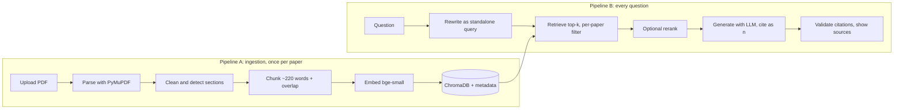

# CiteSure AI

**Trust the evidence behind every citation.**

CiteSure AI is a research-paper assistant built on Retrieval-Augmented Generation (RAG). Upload PDFs, then summarize them, ask questions with verifiable citations, and compare findings across papers. Every answer is grounded in the paper text, and every `[n]` citation is checked in code against the passages that were actually retrieved.

[](https://github.com/AmanGawar/citesure-ai/actions)
 

> Add a 60-90 second demo GIF here (upload, ask, open a citation, compare), then delete this line.

## Why it exists
Reading one paper properly takes hours, and a literature review needs dozens. Pasting a PDF into a general chatbot often gives no page references, invents sources, and breaks on long or multiple documents. CiteSure AI retrieves the exact passages first, answers only from them, and says "I couldn't find that" when the evidence isn't there.

## Features
| Capability | What you get |
|---|---|
| **Ask with citations** | Short answers with numbered references that open the exact passage, section and page. Invalid citations are flagged. |
| **Structured summary** | TL;DR plus Problem, Method, Data, Results and Limitations, each with its own sources. |
| **Cross-paper comparison** | Pick 2-5 papers and aspects; get a markdown table with citations in each cell. |
| **Grounding guardrails** | Relevance threshold, explicit not-found fallback, citation validation, prompt-injection-aware prompting. |
| **Retrieval upgrades** | Optional hybrid BM25 + vector search (RRF) and cross-encoder reranking, switched on by config flags. |
| **Evaluation harness** | Golden set, hit@k, MRR, LLM-judged faithfulness, correct-refusal rate. |
| **Ships properly** | Streamlit UI, FastAPI REST API, pytest suite, GitHub Actions CI, Docker. |

## Architecture


**Stored per chunk:** `chunk_id`, `paper_id` (content hash), `title`, `section`, `page`, text and embedding.

## Quick start
```bash
git clone https://github.com/AmanGawar/citesure-ai.git && cd citesure-ai
python3 -m venv .venv && source .venv/bin/activate      # Windows: .venv\Scripts\activate
pip install -r requirements.txt
cp .env.example .env                                     # then add your ANTHROPIC_API_KEY
streamlit run streamlit_app.py
```
The first run downloads the ~130 MB embedding model. Embeddings run locally and for free; only the LLM calls cost money (a few cents while developing). Use open-access papers (for example from arXiv) and do not commit PDFs.

### Docker
```bash
docker compose up --build                       # UI on http://localhost:8501
docker compose --profile api up --build         # also starts the API on http://localhost:8000
```

### REST API
```bash
uvicorn api:app --reload                        # Swagger docs at http://127.0.0.1:8000/docs
curl -F "file=@data/papers/paper.pdf" http://127.0.0.1:8000/papers
curl -X POST http://127.0.0.1:8000/ask -H "Content-Type: application/json" \
  -d '{"question": "What optimizer and learning-rate schedule were used?"}'
```
Endpoints: `POST /papers`, `GET /papers`, `DELETE /papers/{id}`, `POST /ask`, `GET /papers/{id}/summary`, `POST /compare`.

## Deploy on Streamlit Community Cloud
1. Push this repo to GitHub (the `.env` file and `data/` are git-ignored).
2. Go to [share.streamlit.io](https://share.streamlit.io), choose **New app**, select the repo, branch `main`, and main file `streamlit_app.py`. Set Python to 3.11 under advanced settings.
3. Open **App settings > Secrets** and paste:
   ```toml
   ANTHROPIC_API_KEY = "your-key-here"
   ```
4. Deploy. The first boot is slow while the embedding model downloads.

Notes for a public demo:
- **Protect your wallet.** Set a spend limit in your LLM provider console. The app caps each session at `MAX_QUESTIONS` (default 40).
- Streamlit Cloud storage is temporary, so the index resets when the app restarts.
- `pysqlite3-binary` is installed on Linux to satisfy ChromaDB's SQLite requirement; `streamlit_app.py` swaps it in automatically.
- The free tier has limited memory. If the app runs out, keep `USE_RERANK=false` (the reranker is a second model).

## Configuration
| Variable | Default | Purpose |
|---|---|---|
| `ANTHROPIC_API_KEY` | none | LLM access |
| `LLM_MODEL` | `claude-sonnet-5-5` | Model used for answers, summaries and the judge |
| `EMBED_MODEL` | `BAAI/bge-small-en-v1.5` | Local embedding model |
| `TOP_K` / `MIN_SCORE` | `6` / `0.30` | Chunks sent to the LLM / relevance threshold |
| `CHUNK_WORDS` / `CHUNK_OVERLAP` | `220` / `40` | Chunking |
| `USE_HYBRID` / `USE_RERANK` | `false` | Retrieval upgrades |
| `MAX_QUESTIONS` | `40` | Per-session question cap |

## Evaluation
```bash
python -c "from citesure.store import PaperStore; print(PaperStore().list_papers())"   # find your paper_id values
# edit eval/golden.jsonl: 6-10 answerable questions per paper plus 5-10 unanswerable ones
python eval/run_eval.py
```
Retrieval is measured by **hit@k** and **MRR**; answers by **LLM-judged faithfulness** and **correct "not found" rate** on unanswerable questions. Change one thing at a time and record it below. These cells are empty on purpose: fill them with your own measured numbers.

| Experiment | Hit@6 | MRR | Faithful | Latency | Takeaway |
|---|---|---|---|---|---|
| Baseline (220 words, bge-small) | - | - | - | - | |
| Chunk size 120 / 400 words | - | - | - | - | |
| Overlap 0 / 40 / 80 | - | - | - | - | |
| bge-base vs bge-small | - | - | - | - | |
| k = 3 / 6 / 10 | - | - | - | - | |
| + Hybrid BM25 + vector | - | - | - | - | |
| + Cross-encoder rerank | - | - | - | - | |
| Without query rewriting (multi-turn) | - | - | - | - | |

A small self-written golden set is easy to overfit and may favor easy phrasing, and an LLM judge is imperfect. Spot-check some verdicts by hand.

## Design decisions
- **Plain Python, no framework:** every step is explicit and explainable.
- **~220-word chunks with 40-word overlap, never crossing sections:** precise but self-contained; tuned with evidence.
- **Local bge-small embeddings, normalized cosine:** free, private, strong on retrieval benchmarks. The BGE query prefix is applied to questions only.
- **ChromaDB:** zero-ops with metadata filtering. FAISS, Qdrant or pgvector are the scale-up path.
- **Facet-based summaries instead of stuffing the whole PDF:** cheaper, citable, and works on long papers.
- **Per-paper retrieval for comparisons:** one long paper cannot crowd out the others.
- **Programmatic citation validation:** cheap, transparent and testable.

## Limitations
- Scanned PDFs have no text layer (OCR is future work).
- Heading detection uses a regex, titles are heuristic, and tables and equations come out as messy text.
- Hyphenated words split at line breaks can be joined wrongly.
- Citation validation checks that a cited number exists, not that the claim is actually true.
- Prompt injection through PDF text is mitigated, not eliminated.

## Project structure
```
citesure/       config, ingest, store, prompts, llm, service, hybrid, rerank
streamlit_app.py   web UI          api.py   REST API
eval/           golden.jsonl, run_eval.py
tests/          test_ingest.py, test_prompts.py
.github/workflows/tests.yml   CI   Dockerfile, docker-compose.yml
```
Run the tests with `pytest -q`. They cover cleaning, chunking and citation parsing; LLM and embedding quality is covered by the evaluation harness instead.

## Roadmap
OCR for scans, layout-aware parsing (pymupdf4llm or GROBID), import by arXiv ID, streaming answers, citation graph, caching, observability, per-user libraries.

## License
MIT. See `LICENSE`.
